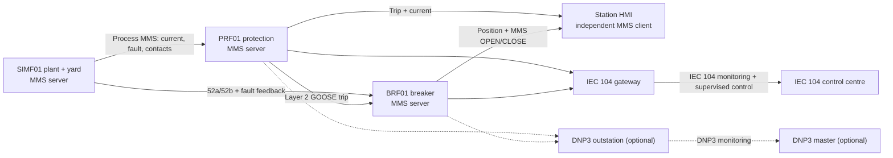

# Virtual Substation OT

SS-01 is an isolated **training simulation**, not an industrial protection
device or a standards-conformance claim. Separate simulated plant, protection
and breaker IED processes exchange native protocol traffic. PRF01 sends trip
to BRF01 over GOOSE; contact-confirmed breaker position returns to the station
and gateways over MMS. There is no reverse breaker-position GOOSE today.

The [as-built reference](docs/as-built.md) distinguishes the repository's
implemented profiles from a dated running-deployment snapshot.

## Quick start

```bash
./setup.sh
```

Tries pre-built images from GHCR first (seconds), falls back to a local Docker build (several minutes, compiles from source), and falls back further to the native build (`install.sh`) if Docker itself isn't installed. Each path reports missing prerequisites with an install hint instead of a raw tool error.

Once it's running, open the [lab overview](http://127.0.0.1:8080/lab-overview) for links and reachability of every configured asset, or jump straight to a [service URL](#service-urls) below.

## Architecture

SS-01 models one 33/11 kV substation with a single 11 kV outgoing feeder bay (F01), as independent processes that talk over the real protocols rather than one simulator standing in for everything:



| Component | Role | Protocol it speaks |
|---|---|---|
| SIMF01 | Numerical feeder and breaker mechanism; owns 52a/52b contacts and process fault state | MMS server |
| PRF01 | Feeder protection: evaluates phase-A current, latches trip | MMS server, GOOSE publisher |
| BRF01 | Breaker control: receives the GOOSE trip, drives the breaker, confirms position from contacts | GOOSE subscriber, MMS client (to SIMF01), MMS server |
| Station HMI | Single-line, control, events | Independent MMS client |
| Gateway | MMS-to-IEC 104 (and optional DNP3) bridge | MMS client, IEC 104/DNP3 server |
| Control centre | Remote monitoring and supervised switching | IEC 104/DNP3 master |
| Kali (optional) | Attacker/analysis workstation for the security-training exercises | Supervisory network only |

**The sequence that matters most**: PRF01 evaluates current -> on overcurrent it latches a trip and publishes it over **GOOSE** -> BRF01 accepts the trip and operates the breaker -> BRF01's contact-derived position and PRF01's trip both flow back over **MMS** to the station HMI and gateway -> the gateway republishes over **IEC 104** (monitoring and supervised control) and optionally **DNP3** (monitoring only) to a remote control centre. Closing is blocked at BRF01 itself, not just in the UI, while the trip is asserted or current is above pickup; both PRF01's trip latch and BRF01's close-inhibit latch need an explicit reset before a close is accepted.

See [docs/ss01-architecture.md](docs/ss01-architecture.md) for the complete target architecture, including planned and experimental process-bus paths, and the full signal-ownership table.

## Installation

Three paths, fastest first. `./setup.sh` tries them in this order automatically.

| Path | Command | Needs |
|---|---|---|
| 1. Pre-built images (seconds) | `docker compose -f compose.yaml -f compose.prebuilt.yaml pull && docker compose -f compose.yaml -f compose.prebuilt.yaml up -d` | Docker only -- pulls from `ghcr.io/pg-ot/virtual_substation_ot` instead of building |
| 2. Local Docker build (a few minutes) | `docker compose -f compose.yaml up -d --build` | Docker, plus internet access on the first build to fetch libiec61850, lib60870 and opendnp3 |
| 3. Native build, no Docker (Linux) | `./install.sh && node native/smoke.mjs build-native --dnp3` | cmake >=3.24, a C++17 compiler, a build tool, Java and Node >=20 -- `install.sh` checks these up front and reports what's missing |

Add `-f compose.http-input.yaml` for instructor-controlled current injection, or `--profile dnp3` for the optional DNP3 pair. See [docs/container-bench.md](docs/container-bench.md) for every overlay and the native build's console exercise is in [native/README.md](native/README.md#browser-consoles).

## Service URLs

With the base Docker Compose deployment running (default ports):

| URL | Service |
|---|---|
| http://127.0.0.1:8080/ | Station HMI -- single-line, breaker control, events |
| http://127.0.0.1:8080/lab-overview | Lab overview -- links and reachability for every configured asset |
| http://127.0.0.1:8081/ | SIMF01 process diagnostics |
| http://127.0.0.1:8081/yard/ | 3D switchyard and control room |
| http://127.0.0.1:8082/ | PRF01 protection IED console |
| http://127.0.0.1:8083/ | BRF01 breaker IED console |
| http://127.0.0.1:8084/ | IEC 104 gateway |
| http://127.0.0.1:8085/ | IEC 104 control centre (remote monitoring and supervised control) |
| http://127.0.0.1:8086/ | DNP3 outstation (needs `--profile dnp3`) |
| http://127.0.0.1:8087/ | DNP3 master (needs `--profile dnp3`) |
| http://127.0.0.1:6088/vnc.html | Kali attacker/analysis desktop (needs `-f compose.kali.yaml --profile kali`) |

Override any port with its `LAB_*_PORT` environment variable (e.g. `LAB_HMI_PORT`) to run more than one project at once -- see [docs/container-bench.md](docs/container-bench.md).

For capture controls without interrupting an existing HMI, start the [host capture agent](docs/container-bench.md#packet-capture-from-the-lab-overview) and use its separate overview.

## Kali desktop credentials

The noVNC desktop password is fixed: `ss01kali`.

```bash
docker compose -f compose.yaml -f compose.kali.yaml --profile kali up -d --build --wait kali-access
```

Open http://127.0.0.1:6088/vnc.html and enter `ss01kali`. This password is fixed in `containers/kali-desktop.sh`, which every deployment of this repository mounts into the container read-only at startup -- anyone with a checkout of this repository knows it. Keep the Kali desktop on an isolated training network, and edit that file to a different, private value before exposing it any more widely than host loopback.

## Documentation

| If you're... | Start with |
|---|---|
| Running or operating the lab | [Container runbook](docs/container-bench.md) and [native build and operations](native/README.md) |
| Teaching a session | [Instructor guide](docs/training-f01-instructor-guide.md), [scenario guide](docs/instructor-scenarios.md) and [facilitator guide](docs/training-facilitator.md) |
| Checking what's actually implemented | [As-built reference](docs/as-built.md) and [architecture](docs/ss01-architecture.md) |
| Reviewing test evidence or acceptance gaps | [Scenario test cases](docs/scenario-test-cases.md) and [implementation checklist](docs/iec61850-implementation-checklist.md) |
| Looking for design rationale | [ADRs](docs/adr/README.md) |

The [full documentation index](docs/README.md) maps every other document -- protocol profiles, trainee worksheets, aligned presentations, secure remote access, and resilience/recovery exercises -- to where it lives and when to update it.

Never put passwords, credentials or sensitive captures in these documents. Document the evidence location and access procedure without publishing secrets.
