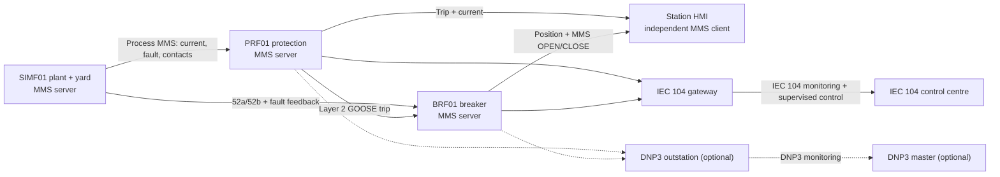

# Virtual Substation OT

SS-01 is an isolated **training simulation**, not an industrial protection
device or a standards-conformance claim. Separate simulated plant, protection
and breaker IED processes exchange native protocol traffic. PRF01 sends trip
to BRF01 over GOOSE; contact-confirmed breaker position returns to the station
and gateways over MMS. There is no reverse breaker-position GOOSE today.

The [as-built reference](docs/as-built.md) distinguishes the repository's
implemented profiles from a dated running-deployment snapshot. The
[lab overview](http://127.0.0.1:8080/lab-overview) is available when a
compatible station HMI is running on the default port. Other projects may use
different ports. For capture controls without interrupting an existing HMI,
start the [host capture agent](docs/container-bench.md#packet-capture-from-the-lab-overview)
and use its separate overview.

## Architecture

SS-01 models one 33/11 kV substation with a single 11 kV outgoing feeder bay (F01), as independent processes that talk over the real protocols rather than one simulator standing in for everything:



| Component | Role | Protocol it speaks |
|---|---|---|
| SIMF01 | Numerical feeder and breaker mechanism; owns 52a/52b contacts and process fault state | MMS server |
| PRF01 | Feeder protection: evaluates phase-A current, latches trip | MMS server, GOOSE publisher |
| BRF01 | Breaker control: receives the GOOSE trip, drives the breaker, confirms position from contacts | GOOSE subscriber, MMS client (to SIMF01), MMS server |
| Station HMI | Single-line, control, events | Independent MMS client |
| Gateway | MMS-to-IEC 104 (and optional DNP3) bridge | MMS client, IEC 104/DNP3 server |
| Control centre | Remote monitoring and supervised switching | IEC 104/DNP3 master |
| Kali (optional) | Attacker/analysis workstation for the security-training exercises | Supervisory network only |

**The sequence that matters most**: PRF01 evaluates current -> on overcurrent it latches a trip and publishes it over **GOOSE** -> BRF01 accepts the trip and operates the breaker -> BRF01's contact-derived position and PRF01's trip both flow back over **MMS** to the station HMI and gateway -> the gateway republishes over **IEC 104** (monitoring and supervised control) and optionally **DNP3** (monitoring only) to a remote control centre. Closing is blocked at BRF01 itself, not just in the UI, while the trip is asserted or current is above pickup; both PRF01's trip latch and BRF01's close-inhibit latch need an explicit reset before a close is accepted.

See [docs/ss01-architecture.md](docs/ss01-architecture.md) for the complete target architecture, including planned and experimental process-bus paths, and the full signal-ownership table.

## Documentation: what belongs where

| Information needed | Where to find or record it |
|---|---|
| Current implemented devices, signal ownership, protocol paths, settings, point mappings, limitations and a dated deployment snapshot | [As-built reference](docs/as-built.md). Update it when implementation or the documented deployment changes; distinguish source from a verified running image. |
| Station, bay, process and supervisory topology, alternatives and network boundaries | [Architecture](docs/ss01-architecture.md). Label implemented, experimental and planned paths separately. |
| Startup, ports, profile selection, operation, captures and safe isolation | [Container runbook](docs/container-bench.md); native-only commands and settings are in [native build and operations](native/README.md). Record the project, overlays and port overrides used. |
| Engineered data model, GOOSE dataset/address/revision and runtime configuration | Versioned [feeder CID](native/feeder.cid), Compose files and the as-built reference. Record changes to dataset order or revision and the matching publisher/subscriber configuration. |
| Protocol editions, roles, optional services, point maps and interoperability requirements | [Device profiles and release criteria](specs/001-feeder/protocol-profiles.md), with implemented mappings in the [as-built reference](docs/as-built.md). Record unsupported functions and do not treat target profiles as certification. |
| Test cases, results, captures, build identity, topology, dates, failures and limitations | [Scenario test cases](docs/scenario-test-cases.md), [latest isolated run](outputs/scenario-validation-20261123/report.md), [technical validation](docs/f01-technical-validation.md) and dated [evidence reports](outputs/iec61850-implementation-validation.md). Keep historical observations intact; add new evidence with its own scope and links. |
| Open IEC 61850 acceptance work | [Implementation checklist](docs/iec61850-implementation-checklist.md) and [GOOSE run sheet](specs/001-feeder/p1-linux-run.md). Mark a test complete only with evidence for the stated scope. |
| Training scenarios and instructor instructions | [Direct-HTTP pilot guide](docs/training-direct-http-pilot.md), [instructor guide](docs/training-f01-instructor-guide.md) and [scenario guide](docs/instructor-scenarios.md). Select the correct measurement profile; record prerequisites and expected feedback separately from commands. |
| Trainee practical worksheets for all four sessions | [Practical workbook PDF](outputs/SS-01-practical-workbook.pdf) or [editable Word version](outputs/SS-01-practical-workbook.docx). Instructors should rehearse the selected profiles and provide project-specific addresses. |
| Kali desktop activities for all four sessions | [Kali student practicals](docs/container-bench.md#student-practicals-on-the-kali-desktop), including capture analysis and backup hash verification. Instructor operations remain separate. |
| Session flow, preflight, timings and answer guidance | [Four-session facilitator guide](docs/training-facilitator.md). Perform the human trainee rehearsal and document sign-off before release. |
| Revised presentations aligned with the practicals | [Session 1: IEC 62443](outputs/SS-01-Session-1-aligned.pptx) · [Session 2: protocol analysis](outputs/SS-01-Session-2-aligned.pptx) · [Session 3: secure access](outputs/SS-01-Session-3-aligned.pptx) · [Session 4: recovery](outputs/SS-01-Session-4-aligned.pptx). Original presentations are unchanged. |
| Optional VPN and jump-host exercise, configuration, session controls and security boundaries | [Secure remote access training pilot](docs/training-secure-remote-access.md). This local container-to-container demonstration is off by default and does not protect the existing direct lab interfaces. |
| IEC 104 configuration fault, hash-verified restore and RTO/RPO / 3-2-1 teaching | [Resilience and recovery exercise](docs/training-resilience-recovery.md). Use a separate disposable project; control requires a separate authorized test, and historical data is not backed up. |
| Design rationale, proposed work and future acceptance | [ADRs](docs/adr/README.md), [architecture plan](specs/001-feeder/full-architecture-plan.md) and [low-level design](specs/001-feeder/low-level-design.md). Treat proposals as targets, not as-built facts. |

Never put passwords, credentials or sensitive captures in these documents.
Document the evidence location and access procedure without publishing secrets.

## Quick start

```bash
./setup.sh
```

Tries pre-built images from GHCR first (seconds), falls back to a local Docker build (several minutes, compiles from source), and falls back further to the native build (`install.sh`) if Docker itself isn't installed. Each path reports missing prerequisites with an install hint instead of a raw tool error.

## Installation

Three paths, fastest first. `./setup.sh` tries them in this order automatically.

### 1. Pre-built images (seconds, no compiler needed)

```bash
docker compose -f compose.yaml -f compose.prebuilt.yaml pull
docker compose -f compose.yaml -f compose.prebuilt.yaml up -d
```

Pulls published images from `ghcr.io/pg-ot/virtual_substation_ot` instead of building. Add `-f compose.http-input.yaml` for instructor-controlled current injection, or `--profile dnp3` for the optional DNP3 pair (see [docs/container-bench.md](docs/container-bench.md) for all overlays).

### 2. Local Docker build (a few minutes)

```bash
docker compose -f compose.yaml up -d --build
```

Builds everything from source inside Docker. Needs internet access to fetch libiec61850, lib60870 and opendnp3 on the first build.

### 3. Native build (Linux, no Docker)

```bash
./install.sh
node native/smoke.mjs build-native --dnp3
```

Checks for cmake (>=3.24), a C++17 compiler, a build tool, Java and Node (>=20) up front and reports exactly what's missing with an install hint, before attempting the several-minute compile. See [Build and run](#build-and-run) below for the console-based exercise this unlocks.

## Service URLs

With the base Docker Compose deployment running (default ports):

| URL | Service |
|---|---|
| http://127.0.0.1:8080/ | Station HMI -- single-line, breaker control, events |
| http://127.0.0.1:8080/lab-overview | Lab overview -- links and reachability for every configured asset |
| http://127.0.0.1:8081/ | SIMF01 process diagnostics |
| http://127.0.0.1:8081/yard/ | 3D switchyard and control room |
| http://127.0.0.1:8082/ | PRF01 protection IED console |
| http://127.0.0.1:8083/ | BRF01 breaker IED console |
| http://127.0.0.1:8084/ | IEC 104 gateway |
| http://127.0.0.1:8085/ | IEC 104 control centre (remote monitoring and supervised control) |
| http://127.0.0.1:8086/ | DNP3 outstation (needs `--profile dnp3`) |
| http://127.0.0.1:8087/ | DNP3 master (needs `--profile dnp3`) |
| http://127.0.0.1:6088/vnc.html | Kali attacker/analysis desktop (needs `-f compose.kali.yaml --profile kali`) |

Override any port with its `LAB_*_PORT` environment variable (e.g. `LAB_HMI_PORT`) to run more than one project at once -- see [docs/container-bench.md](docs/container-bench.md).

## Kali desktop credentials

There is no fixed password. Each time the Kali container starts, it generates a random one and prints it to its own log:

```bash
docker compose -f compose.yaml -f compose.kali.yaml --profile kali up -d --build --wait kali-access
docker compose -f compose.yaml -f compose.kali.yaml logs kali
```

Open http://127.0.0.1:6088/vnc.html and enter the password shown as `SS-01 noVNC desktop password: <token>` in that log. Log rotation can remove the startup message; the only way to get a new one is to restart the container, which needs operator approval since it disrupts anyone already connected.

## Run the containerized bench

The [Docker Compose guide](docs/container-bench.md) covers every overlay (HTTP input, Kali, DNP3, secure access, recovery) and the successful-trip and failed-breaker exercises in detail.

## Build and run

See [Installation](#installation) above to build (`./install.sh`). Once built, run the console-level smoke check and the GOOSE exercise below.

```bash
node native/console-smoke.mjs build-native
```

For the GOOSE exercise, use an isolated station Ethernet interface on Linux. The native processes need raw Ethernet permission on their selected interface. Launch each console in its own terminal as an unprivileged user with the required capability granted to the native binary by the lab administrator.

```bash
./start_protection.sh <publisher-station-interface>
./start_breaker.sh <subscriber-station-interface>
```

| Console | Address | Data path |
|---|---|---|
| Protection IED | http://127.0.0.1:8211/ | An MMS client reads the live feeder IED. Instructor actions go to the IED process. |
| Breaker IED | http://127.0.0.1:8212/ | BRF01 exposes received GOOSE and separately publishes its own breaker position over MMS. |
| Station HMI | http://127.0.0.1:8080/ | An independent native MMS client reads BRF01 position and PRF01 trip and current. |

Use `./start_protection.sh -` for the MMS-only console. On Windows use `node src/native-device-console.mjs protection - <build-directory>`. Stop each launcher with Ctrl+C. The console and its child process can be stopped separately from the other device.

Set `LAB_CONSOLE_PORT` for an alternate console binding. The native protocol ports can also be overridden for local tests.

### Read-only station HMI

Start both IEDs using the [distributed breaker exercise](native/README.md#distributed-breaker-exercise), then run:

```text
node src/serve.mjs --native build-native
node native/station-hmi-smoke.mjs build-native
```

Run the smoke test separately from the live exercise, or give it separate MMS ports. Set `PORT` for an alternate HMI HTTP port. Match `LAB_MMS_PORT` and `LAB_BREAKER_MMS_PORT` to the running IEDs. The station displays source timestamps and per-point quality. Its event table records changes observed by the station poller.

### Exercise

1. Open both consoles. Verify confirmed CLOSED over MMS and LIVE GOOSE indications at the peer.
2. Apply a fault in the protection console. Observe the OPEN confirmation over MMS and the state change at the GOOSE peer. Heartbeat retransmissions update the sequence number and last receipt without creating a new state event.
3. Stop the publisher. The peer retains the last received values and marks them STALE when their lifetime expires.

The breaker console shows the received GOOSE trip alongside BRF01's confirmed position. Isolated Linux GOOSE and MMS feedback exercises have been observed; full timing, independent interoperability and conformance remain open. See the [as-built reference](docs/as-built.md) and [ADR 0016](docs/adr/0016-full-feeder-bay.md).

## Other layers

- [Full architecture implementation plan](specs/001-feeder/full-architecture-plan.md) maps the reference diagram to build phases, interfaces and acceptance tests.

- [Native device build](native/README.md) documents the independent MMS client, IEC 104 gateway and master, and DNP3 outstation and master. The distributed supervisory variants read position from BRF01 and protection and current from PRF01.
- [Feature tasks](specs/001-feeder/tasks.md) and [ADRs](docs/adr/README.md) track pending browser connections, station configuration and independent interoperability.
- `station-hmi.html` is the offline classroom prototype. The new protection and breaker consoles connect to the running processes.
- The reference Tkinter source and bundled examples remain in the repository for comparison. The supported launchers use the pinned native build and the new console paths.
