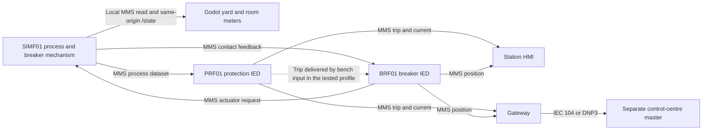

# SS-01 F01 technical validation

**Date:** 21 November 2026  
**Verdict:** Distributed training-bench monitoring passed. Automatic protection delivery, supervisory control, and industrial acceptance remain open.

**Historical scope:** This report records the 21 November fixture and its
observations; statements about injected trip, fixed settings, SV availability
and deployment describe that run, not the current source. Later isolated
GOOSE and HTTP-input exercises passed within their stated scopes. Consult the
[as-built reference](as-built.md) and [implementation assessment](../outputs/iec61850-implementation-validation.md)
for newer configurations and outstanding acceptance.

## Actual data paths



SIMF01 owns mechanism state and process values. The yard displays those values and has no switching or fault-injection controls. The HMI and each gateway are independent MMS clients. The master endpoints are separate in-repository protocol peers, exercised on loopback. Browser views use their own origin.

| Signal | Authority and mapping | Coverage |
|---|---|---|
| Source voltage | SIMF01 `GGIO1.AnIn1`, 11 kV | Yard and process diagnostics. HMI and remote point lists omit it. |
| Feeder current | SIMF01 `GGIO1.AnIn2` feeds PRF01 `MMXU1.A.phsA` | 120 A normally, 1,200 A with a closed breaker and applied fault, 0 A after opening. IEC 104 CA 1 / IOA 102. DNP3 analog input 0, Class 2 events. Only one current value reaches the relay and SCADA. |
| Breaker contacts and position | SIMF01 `GGIO1.Ind1` and `Ind2` feed BRF01 `XCBR1.Pos` | Raw contacts on the yard and plant page. Derived position at the HMI and masters. IEC 104 CA 1 / IOA 100. DNP3 double-bit input 0, Class 1 events. |
| Process fault and protection trip | SIMF01 `GGIO1.Ind3` is the scenario input. PRF01 asserts and latches `PTRC1.Tr.general` when valid measured feeder current reaches the fixed 200 A pickup. Reset also requires the process fault to be clear and valid current below pickup. | Yard has the scenario fault indication. HMI and masters have the relay trip latch. IEC 104 CA 1 / IOA 101. DNP3 binary input 0, Class 1 events. |
| Breaker operation failure | BRF01 `GGIO1.Ind1` | Native BRF01, breaker diagnostics, station HMI, IEC 104 CA 1 / IOA 103, and DNP3 binary input 1, Class 1 events. |
| Breaker close-inhibit latch | BRF01 `GGIO1.Ind2` | Station HMI, IEC 104 CA 1 / IOA 104 and DNP3 binary input 2, Class 1 events. The supervisory mappings were tested in an isolated rebuilt image. |

IEC 104 uses untimed general interrogation and CP56Time2a spontaneous ASDUs. DNP3 uses link addresses 1 (master) and 10 (outstation), Class 1 and 2 scans, and integrity scans. Both master endpoints received the timed OPEN event with the BRF01 contact source timestamp in this run. The test allows 1 ms for representation differences. Source times in this fixture come from host clocks. The gateway mappings collapse MMS quality to good or invalid/offline. They carry neither the full IEC 61850 quality details nor a station clock synchronization state. Gateway and HMI reading is polling-based in distributed mode, so a successful steady-state check does not establish lossless sequence-of-events recording.

## Evidence

| Check | Observed result |
|---|---|
| Deployed baseline, read-only | Loopback HTTP ports 8080–8085 answered. SIMF01 showed 11 kV, 120 A, 52a on, 52b off, and fault clear. PRF01 showed no trip. BRF01, the HMI, and the IEC 104 gateway and master agreed on CLOSED where applicable. The HMI and both IEC 104 endpoints agreed on 120 A with good quality. The deployed yard returned HTTP 200 and lacked the current control-room navigation. Ports 8086 and 8087 refused connections. |
| Main chain on current source | Rebuilt all eight native binaries with DNP3 enabled. Baseline, fault pickup, manual delivery to BRF01, timed OPEN, and final OPEN / 0 A were observed across the separate native station HMI, gateways, and both master processes. Source voltage remained 11 kV and relay trip remained latched. The test verified the plant-only yard HTML and applied real plant HTTP data to the same decoder used by the browser. |
| Reset, closing and trip priority | Process MMS tests confirmed reset rejection while the fault persisted. Clearing the process, resetting PRF01, providing fresh deasserted input, resetting BRF01, and issuing close worked in the bench sequence. A trip during closing superseded close and BRF01 confirmed OPEN. Fixture travel is 300 ms with a 950 ms BRF01 movement deadline. These are simulation parameters. |
| No travel and mid-travel stall | For no travel, BRF01 set operation failure while position remained CLOSED and current stayed at 1,200 A. The HMI and both masters received the alarm and its BRF01 source timestamp. For a stall, the HMI showed valid INTERMEDIATE, then position became invalid at the HMI and both masters. The yard indicated STALLED after SIMF01 re-read both contacts clear beyond the 950 ms movement deadline. |
| Bad data and recovery | Both contacts asserted produced invalid position at the HMI and both gateways and masters. Healthy contact restoration recovered CLOSED. Plant loss invalidated BRF01 position and PRF01 current in the process smoke. Native station tests verified independent point loss and recovery. IEC 104 master marked its points stale on gateway loss and recovered on restart. The DNP3 link remained connected during the IEC 104 outage. |
| 3D presentation | Godot scene tests passed cabinet values, unavailable and contradictory feedback, camera presets, and doorway collision. JavaScript tests passed the yard decoding cases. Browser WebGL on the new deployed image was outside this run. |
| Component protocol functions | The separate combined-IED profile passed native MMS reporting, command termination, and an interlock case, plus IEC 104 general interrogation and events and DNP3 integrity and double-bit events. Its MMS control and unbuffered report tests do not establish those features on the distributed station. |

The current source tests used a fresh loopback fixture and sent scenario commands only to that fixture. Docker API access was denied. Compose configuration validated with DNP3 enabled, while running-image identity, Docker network enforcement, Linux raw Ethernet, and operational trip tests against the deployed stack were outside the observed evidence.

## Acceptance gaps

1. **Automatic trip delivery and process bus.** The default image uses injected trip delivery. The Linux Compose override selects native station GOOSE and has an automatic-trip smoke path, with configuration validation passed and wire validation pending. Prove F01 pickup through actual Layer 2 frames and feedback on the intended isolated Linux topology. The process adapter uses MMS, with no IEC 61850-9-2 Sampled Values, merging unit, or validated process-bus protection timing. [IEC 61850-8-1 mapping](https://webstore.iec.ch/en/publication/59775) · [IEC 61850-9-2 Sampled Values](https://webstore.iec.ch/en/publication/66549)
2. **Position and failure semantics.** The readers now preserve valid intermediate separately from bad-state. BRF01 operation failure remains a bay alarm with a native timestamp. The yard infers stall from SIMF01's contact feedback and displays the feedback timestamp. The yard's no-travel still appears CLOSED, since it receives no BRF01 movement request or alarm. An upstream breaker-failure protection trip is a separate function.
3. **Control and protection coverage.** The station HMI now issues direct-normal MMS OPEN/CLOSE to BRF01 in the process profile and checks independent contact feedback. The native control smoke covers opening, closing with permissives, latch rejection, and accepted operation without movement. IEC 104 and DNP3 remain monitoring paths. Industrial control acceptance still requires a declared authorization model, independent-peer checks, and the chosen command termination semantics. The current fault-bit and current-threshold rule verifies training cause and effect. An engineered feeder profile still requires declared elements and settings, pickup and timing checks, and the appropriate CT/VT inputs.
4. **Engineering and interoperability.** Validate the engineered SCL and enabled services against independent IEC 61850 peers. Build separate interoperability profiles for both supervisory roles, validate invalid and transition states, event queue recovery, restart and reconnect, and test against independent masters and gateways. Declare and verify time synchronization, data freshness, applicable protocol security, and performance under load. OpenDNP3 3.1.2 is pinned to an archived upstream. Record the maintenance approach before industrial acceptance. [IEC 61850-10](https://webstore.iec.ch/en/publication/108858) · [IEC TS 60870-5-604](https://webstore.iec.ch/en/publication/117000) · [DNP Users Group conformance](https://www.dnp.org/Products/Testing-Policy) · [OpenDNP3 upstream](https://github.com/dnp3/opendnp3)

## Reproduce the source checks

From the repository root, using a native directory built with `LAB_DNP3=ON` and Node 20 or newer:

```text
node native/chain-smoke.mjs <native-build-directory>
node native/process-smoke.mjs <native-build-directory>
node native/station-hmi-smoke.mjs <native-build-directory>
node native/distributed-smoke.mjs <native-build-directory> --dnp3
node native/smoke.mjs <native-build-directory> --dnp3
node --test yard/tests/telemetry.test.mjs
godot --headless --path yard --script res://tests/check_scene.gd
docker compose --profile dnp3 config --quiet
```

The complete-chain smoke binds its native protocol endpoints to loopback ports 29701–29705 and gives its HTTP endpoints ephemeral ports. It verifies stalled position and the timed operation-failure alarm alongside the normal functional checks.
