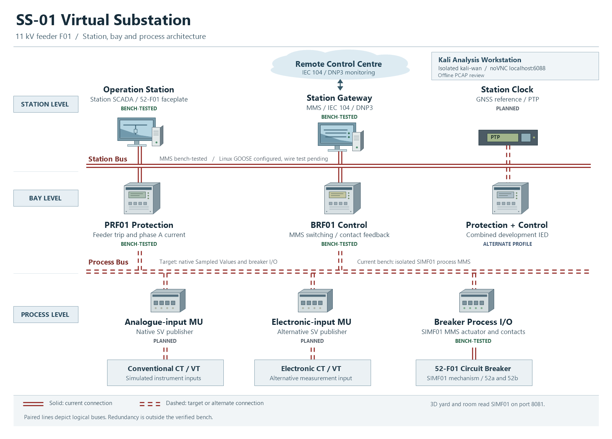
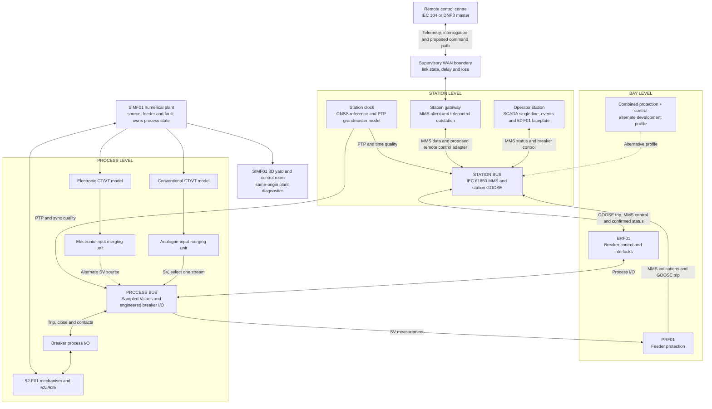
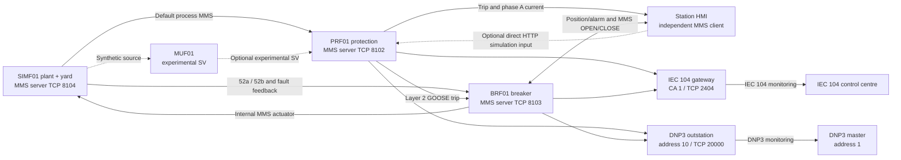

# SS-01 virtual substation architecture

**Scope** A fictional 33/11 kV substation with one active 11 kV outgoing feeder, F01. The target model uses a 50 Hz system. The source transformer and incomer provide electrical context. Breaker 52-F01, feeder measurement, bay protection and control, station SCADA, and remote SCADA form the active acceptance scope. A dedicated engineering workstation is excluded. Engineering data lives in versioned project files.

**Reading the diagrams** The equipment image combines bench-tested and planned elements and contains historical status labels; for example, its GOOSE wire-test and MU labels predate later isolated tests. The flowcharts below distinguish the target from current repository paths. See the [as-built reference](as-built.md) for the actual dataset, signal direction, limitations and a dated deployment snapshot.

The optional Kali workstation sits outside the three substation levels. It joins the supervisory network for WAN-side exercises. A fixed-destination proxy exposes its noVNC desktop on host loopback. Its separate Docker WAN bridge is configured as internal in the current source, not a complete host isolation boundary. The change does not alter an already running network.

## Complete target architecture

The two CT/VT and merging-unit paths are alternatives. Commission one measurement source per F01 protection configuration. The combined IED is a separate profile. F01 in distributed mode uses independent PRF01 and BRF01 devices and one authoritative breaker. The station and process buses are shown as separate logical networks. Redundancy would require an explicit design and acceptance run.

## Reference diagram crosswalk

| Ref. | Reference box | SS-01 design and implementation |
|---|---|---|
| 01 | Control centre | Independent IEC 104 master and optional DNP3 master. IEC 104 monitoring and supervised simulated switching are supported; DNP3 switching is not implemented. Recovery checks and remote switching have separate acceptance criteria. |
| 02 | Operation station | Station HMI, interactive single-line, breaker faceplate, point list and events. Native MMS OPEN/CLOSE with independent BRF01 feedback is bench-tested. |
| 03 | Engineering station | Excluded. Versioned SCL/CID, profiles, point maps and validation scripts replace a dedicated workstation. |
| 04 | Gateway | Independent MMS clients for the IEC 104 and optional DNP3 outstations. Point quality and timestamp handling is implemented for monitoring, with gaps recorded in acceptance. See [ADR 0029](adr/0029-remote-switching-boundary.md) for the simulated IEC 104 control boundary. |
| 05 | GPS clock | Planned simulated GNSS-disciplined station clock, PTP distribution and visible synchronization/holdover status. Current source events use host time. [IEC/IEEE 61850-9-3](https://webstore.iec.ch/en/publication/24998) |
| 06 | Station bus | Isolated `station` network. Native MMS and default Layer 2 GOOSE are implemented. An isolated automatic-trip test and GOOSE capture passed. End-to-end timing and conformance remain open. [IEC 61850-8-1](https://webstore.iec.ch/en/publication/59775) |
| 07 | Protection | PRF01 with its own relay display and trip latch. The default bench input is plant MMS; an optional direct browser-to-PRF01 HTTP simulation input supports slider/sequencer exercises. Experimental SV remains separate. |
| 08 | Control | BRF01 with its own front panel, close interlocks, trip priority, movement supervision and contact-derived position. The process profile exposes direct-normal MMS station control. |
| 09 | Protection + control | Combined native development profile with separate tests. It is an alternative to the distributed bay. |
| 10 | Process bus | Separate `process` network carries SIMF01 MMS. Experimental SV exists in a separate optional profile; an engineered and accepted breaker-I/O mapping remains planned. [IEC 61850-9-2](https://webstore.iec.ch/en/publication/66549) |
| 11 / 14 | Analogue MU and conventional CT/VT | Experimental MUF01 synthesizes an SV stream from the plant model. Engineered instrument-transformer inputs and an accepted measurement profile remain planned. The yard depicts three feeder CTs. [IEC 61869-9](https://webstore.iec.ch/en/publication/24663) |
| 12 / 15 | Digital MU and electronic CT/VT | Planned alternate electronic measurement source. Confirm equivalent primary values, scaling, synchronization and quality before commissioning it. [IEC 61869-9](https://webstore.iec.ch/en/publication/24663) |
| 13 | Breaker process I/O | SIMF01 currently exposes an MMS actuator and independent contact feedback. An engineered process-I/O profile is planned. |
| 16 | Circuit breaker | SIMF01 owns 52-F01 travel and contact feedback. Normal travel, no movement, a mid-travel stall and contradictory contacts are simulated and exercised. The 3D yard displays this process directly. |

## Current application and protocol paths

HTTP input and experimental SV are alternatives, not simultaneous sources.
BRF01 publishes contact-derived position over MMS; a reverse BRF01-to-PRF01
position GOOSE is not implemented. See the [as-built signal register](as-built.md#station-and-remote-points).

### Deployment and isolation

| Network | Members and traffic |
|---|---|
| `station` | PRF01, BRF01, station HMI and gateways. Native station MMS and Layer 2 GOOSE. |
| `process` | SIMF01, PRF01 and BRF01. Process data and internal actuator traffic. |
| `supervisory` | Gateways and remote masters. IEC 104 and optional DNP3. Current Compose connects them on one internal bridge. A distinct WAN boundary and controlled impairment are target work. |
| `management` | Component HTTP bindings published on host IPv4 loopback by the base Compose file. The HMI uses native MMS for breaker control. In the HTTP input profile the station forwards same-origin input and explicit PRF01 reset requests to the relay's web service on the management network. The station reads the downstream CT current separately from SIMF01. |
| `kali-wan` | Optional internal Docker bridge between Kali and its desktop access proxy. Kali also joins `supervisory` for authorized simulated WAN-side exercises. |

| Browser endpoint | Service |
|---|---|
| [8080](http://127.0.0.1:8080/) | Station HMI |
| [8081](http://127.0.0.1:8081/) / [3D yard](http://127.0.0.1:8081/yard/) | SIMF01 diagnostics, process simulation and 3D room |
| [8082](http://127.0.0.1:8082/) / [8083](http://127.0.0.1:8083/) | PRF01 and BRF01 front panels |
| [8084](http://127.0.0.1:8084/) / [8085](http://127.0.0.1:8085/) | IEC 104 gateway and control centre |
| [8086](http://127.0.0.1:8086/) / [8087](http://127.0.0.1:8087/) | DNP3 outstation and master, with the `dnp3` profile |
| [6088](http://127.0.0.1:6088/vnc.html) | Kali browser desktop, with the optional Kali override and profile |

The default Docker deployment enables Layer 2 GOOSE and grants raw socket capability to PRF01 and BRF01. The base deployment and overlays are documented in the [container runbook](container-bench.md).

## Signal ownership and control

| Signal | Authoritative source | Station and process representation | Remote mapping today |
|---|---|---|---|
| Source bus voltage | SIMF01 numerical plant | `SIMF01LD0/GGIO1.AnIn1`, kV. Visible in the yard. | Pending |
| Feeder phase A current | SIMF01 via MMS in the base profile; direct HTTP simulation input can override PRF01 current in the optional profile | `SIMF01LD0/GGIO1.AnIn2` → `PRF01LD0/MMXU1.A.phsA`, A; HTTP mode is labelled separately | IEC 104 IOA 102 short float; DNP3 analog input 0, Class 2 events |
| Process fault | SIMF01 scenario | `SIMF01LD0/GGIO1.Ind3` | Separate from the protection trip point |
| Protection trip | PRF01 latch | `PRF01LD0/PTRC1.Tr.general`; station GOOSE dataset in the Linux profile | IEC 104 IOA 101 single point; DNP3 binary input 0, Class 1 events |
| Breaker raw contacts | SIMF01 mechanism | `SIMF01LD0/GGIO1.Ind1` and `Ind2`; BRF01 derives position | Yard and process diagnostics |
| Breaker position | BRF01 from contacts | `BRF01LD0/XCBR1.Pos`; OPEN, CLOSED, INTERMEDIATE or invalid | IEC 104 IOA 100 double point; DNP3 double-bit input 0, Class 1 events |
| Operation failure | BRF01 movement supervision | `BRF01LD0/GGIO1.Ind1` with source time and quality | IEC 104 IOA 103; DNP3 binary input 1, Class 1 events |
| Close-inhibit latch | BRF01 | `BRF01LD0/GGIO1.Ind2` with source time and quality | Station HMI, IEC 104 IOA 104 and DNP3 binary input 2, Class 1 events |

IEC 104 uses common address 1. DNP3 uses link addresses 1 and 10. The current MMS process dataset and the browser diagnostics use simulated scalar values. Three-phase CT/VT channels, scaling, sampling rate and valid time behavior belong to the selected SV profile. BRF01's operation failure is a movement alarm. Upstream breaker-failure protection is a separate design choice.

### Operator and protection sequences

1. **Station switching.** On the HMI, select 52-F01, choose OPEN or CLOSE, and confirm. The station backend issues native direct-normal MMS control. BRF01 evaluates permit and process state before dispatching the actuator. A separate MMS monitoring read supplies confirmation. If the breaker never travels, the HMI reports that position was not confirmed. CLOSE requires a clear process, valid OPEN feedback, fresh clear protection input and a reset BRF01 latch.
2. **Fault isolation.** SIMF01 applies the scenario in the base profile, or the station HMI sends simulated current directly to PRF01 over HTTP in the optional input profile. PRF01 asserts its trip over GOOSE. BRF01 operates the plant; MMS contact feedback confirms OPEN at the station HMI and gateways. HTTP mode is not IEC process-bus conformance evidence.
3. **WAN loss.** Station protection and local monitoring continue. The remote display marks affected points stale. On recovery, a new interrogation or integrity exchange restores state. Future remote commands must use the same BRF01 authority and remain distinct from restored telemetry.
4. **Time and failure.** Carry validity and source time with each published point, and retain observations separately. Declare the time-quality and invalid-time mapping per protocol. A latched alarm keeps its own assertion time. A later position invalidation needs a new source timestamp.

## Commissioning gates

| Gate | Evidence required |
|---|---|
| Station GOOSE on the wire | Capture publisher and subscriber on the Linux station segment. Correlate one valid trip with one actuator request and contact-confirmed position. Test negative control, expiry, restart, and timing. The earlier PCAP reconstructed TCP headers from real application streams and cannot establish this gate. |
| Process SV, time, and protection | Freeze the engineered CT/VT channel order, primary units, scaling, sample rate, quality, stream identity and synchronization. Verify both measurement variants separately. Prove SV pickup through GOOSE to breaker feedback, then repeat during sample loss and clock loss. |
| Sequence-of-events fidelity | Correct the repeated-stall timestamp regression and define how DNP3 handles invalid startup time. Exercise current, position and alarm mapping with an external master and capture, including data loss and recovery. |
| Remote switching and WAN | Define operator authority, selection or direct-control semantics, execution checks, feedback confirmation and rejection. Verify outage and reconnect behavior, no command replay, and continued local protection. |
| Industrial conformance | Validate generated SCL against engineered roles. Publish IEC 104 interoperability lists and DNP3 Device Profiles. Test with independent MMS, IEC 104 and DNP3 peers. Declare clock, security and any redundancy profiles before claiming compliance. [IEC 61850-10](https://webstore.iec.ch/en/publication/108858) · [IEC 104 conformance tests](https://webstore.iec.ch/en/publication/117000) · [DNP3 conformance policy](https://www.dnp.org/Products/Testing-Policy) |

The [implementation plan](../specs/001-feeder/full-architecture-plan.md) and [low-level design](../specs/001-feeder/low-level-design.md) carry the build phases. The [technical validation](f01-technical-validation.md), [ADR index](adr/README.md), and [Linux GOOSE run sheet](../specs/001-feeder/p1-linux-run.md) record the current evidence and test procedures.
